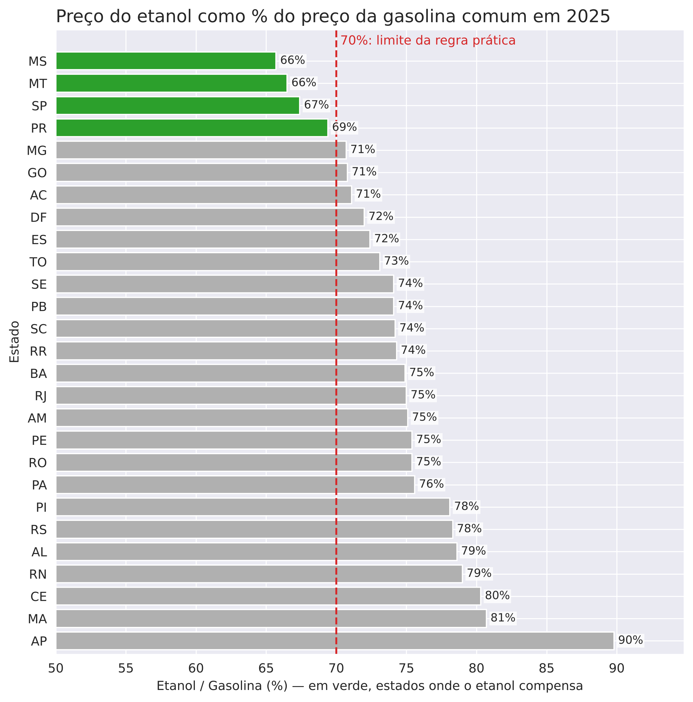
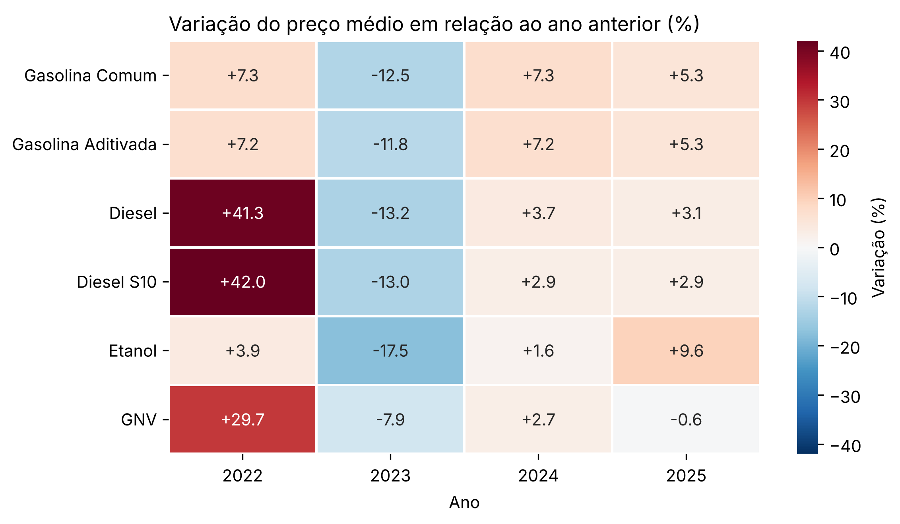
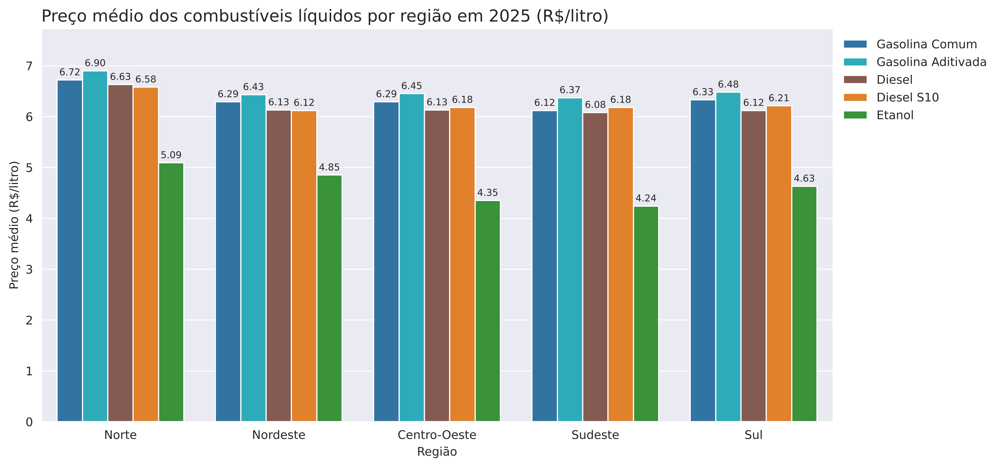
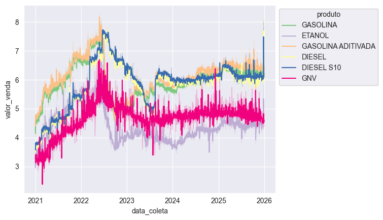
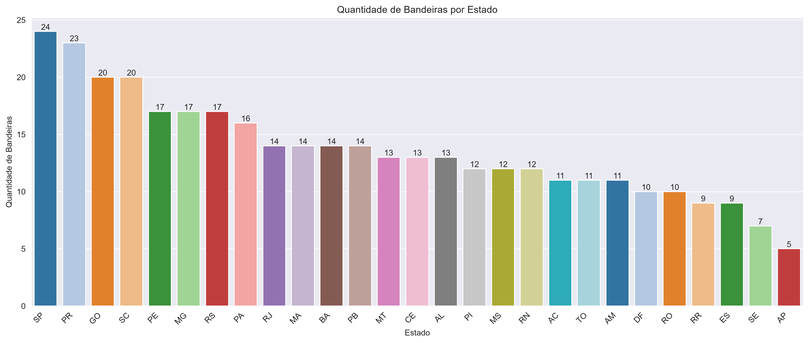

# Projeto ANP — Análise de Preços de Combustíveis

[](https://github.com/apcondessa/ANP_analise_dados/actions/workflows/ci.yml)

Projeto de **Data Analytics** desenvolvido para explorar dados de preços de combustíveis comercializados no Brasil, com foco em análise exploratória, estatística descritiva e visualização.

A base utilizada é composta por arquivos disponibilizados pela **Agência Nacional do Petróleo, Gás Natural e Biocombustíveis (ANP)**. O projeto organiza os dados brutos, prepara uma base para análise e gera indicadores e visualizações sobre preços, produtos, estados e bandeiras.

## Objetivos

- Organizar e tratar os dados de preços de combustíveis.
- Analisar a distribuição dos valores de venda.
- Comparar preços entre estados e produtos.
- Avaliar a evolução dos preços ao longo do período disponível.
- Identificar a quantidade de bandeiras distintas por estado.
- Criar visualizações que facilitem a interpretação dos dados.

## Principais insights (2021–2025)

Base: 4,3 milhões de preços coletados pela ANP em postos de todo o país, de janeiro de 2021 a dezembro de 2025.

1. **2022 foi o ano do pico, seguido de uma queda brusca.** O preço médio mensal da gasolina comum chegou a **R$ 7,29/litro em maio de 2022** e caiu para **R$ 4,86 em outubro**, um recuo de um terço em cinco meses. O diesel S10 teve o pico um pouco depois (**R$ 7,60 em julho de 2022**). A queda coincide com a redução dos tributos estaduais (ICMS) sobre combustíveis em meados de 2022.

2. **O diesel foi o combustível que mais subiu.** O preço médio anual do diesel aumentou **41% em 2022** e terminou 2025 **31% acima de 2021**, contra **+6% da gasolina comum** e **−4,5% do etanol** no mesmo período. Como o diesel move o transporte de cargas, esse aumento tende a se espalhar para o preço de outros produtos.

3. **O etanol ficou mais competitivo, mas só compensa em poucos estados.** Pela regra prática, o etanol vale a pena quando custa menos de **70% do preço da gasolina** (ele rende menos por litro). No Brasil, essa razão caiu de **79% em 2021 para 69% em 2024** e ficou em **71% em 2025**. O número de estados abaixo de 70% passou de **0 (2021) para 9 (2024)** e, em 2025, ficou em **4: MS, MT, SP e PR**, estados com grande produção de etanol (de cana ou de milho). No Amapá, o etanol custou **90%** do preço da gasolina.

4. **A Região Norte é a mais cara.** Em 2025, a gasolina comum custou em média **R$ 6,72 no Norte** contra **R$ 6,12 no Sudeste** (+10%), e o etanol, **R$ 5,09 contra R$ 4,24** (+20%). Entre os estados, a gasolina mais cara foi a do **Acre (R$ 7,67)** e a mais barata, a do **Piauí (R$ 5,93)**: uma diferença de **29%**.

5. **O GNV subiu forte e depois estabilizou.** Alta de **30% em 2022**, e variação de apenas **−0,6% em 2025**. Atenção: em vários estados há pouquíssimas coletas de GNV (RO, RR, PA e GO têm só 1 cada), por isso as comparações entre estados valem apenas para os que têm muitas coletas, como RJ e SP.

6. **São Paulo e Paraná têm a maior variedade de bandeiras** (24 e 23 distribuidoras diferentes), enquanto o Amapá tem apenas 5.

| Etanol como % da gasolina por estado (2025) | Variação anual do preço médio |
|---|---|
|  |  |

| Preço médio por região (2025) |
|---|
|  |

**Limitações:** os preços são **nominais** (sem correção pela inflação); as médias são **simples**, de todos os preços coletados, sem ponderar pelo volume vendido em cada posto; e os dados vêm da amostra de postos pesquisada pela ANP, não de todos os postos do país.

## Resultados

| Evolução do preço por produto | Bandeiras por estado |
|---|---|
|  |  |

## Produtos analisados

- Gasolina (comum)
- Gasolina aditivada
- Diesel
- Diesel S10
- Etanol
- GNV

> A disponibilidade de cada produto depende dos registros presentes nos arquivos da ANP utilizados no projeto.

## Tecnologias

- Python
- Pandas
- Matplotlib
- Seaborn
- PyArrow (formato Parquet)
- PostgreSQL e SQL (scripts em `sql/` e notebook `Geracao_insights.ipynb`)
- Jupyter Notebook
- pytest e Ruff (testes e verificação de estilo)
- GitHub Actions (integração contínua)
- Git/GitHub

## Estrutura do projeto

```text
ANP_analise_dados/
│
├── data/
│   ├── raw/                         # CSVs originais da ANP (não versionados)
│   └── processed/                   # Base tratada (gerada pelo src, não versionada)
│       └── dados_anp_tratados.parquet
│
├── notebooks/
│   ├── Geracao_insights.ipynb       # Análise exploratória e indicadores
│   └── Tecnicas_visualizacao.ipynb  # Visualizações
│
├── outputs/                         # Gráficos gerados (PNG)
│
├── sql/                             # Scripts SQL (PostgreSQL)
│   ├── 01_criar_tabelas.sql         # Esquema, staging e tabela final
│   ├── 02_transformar.sql           # Tratamento dos dados em SQL
│   └── 03_consultas_analise.sql     # Análises em SQL
│
├── src/                             # Código Python reutilizável
│   ├── __init__.py
│   ├── analysis.py                  # Estatísticas descritivas
│   ├── carregar_banco.py            # Carrega os CSVs no PostgreSQL
│   ├── data_processing.py           # Leitura e tratamento dos CSVs
│   ├── download.py                  # Baixa os CSVs do site da ANP
│   ├── main.py                      # Executa o fluxo completo
│   └── visualization.py             # Gráficos
│
├── tests/                           # Testes automatizados (pytest)
│
├── requirements/
│   ├── requirements.txt             # Dependências do projeto
│   └── requirements-dev.txt         # + ferramentas de teste e estilo
│
├── .github/workflows/ci.yml         # Testes automáticos no GitHub (CI)
├── .env.example                 # Modelo das variáveis do banco (copie para .env)
├── .gitignore
├── pyproject.toml                   # Configuração do pytest e do Ruff
└── README.md
```

## Requisitos

- **Python 3.11 ou superior** (o projeto foi desenvolvido com Python 3.14).
- Cerca de **2 GB de memória RAM livre** (pico medido: 1,7 GB) e **1 GB de disco** para os dados brutos.

## Obtendo os dados

Os CSVs da ANP **não estão neste repositório** (somam cerca de 750 MB).

**Forma automática (recomendada):** na raiz do projeto, com o ambiente virtual ativo, execute:

```bash
python src/download.py
```

O script baixa os 10 semestres de 2021 a 2025, extrai os arquivos `.zip` e salva os CSVs em `data/raw/` (`ca-2021-01.csv`, `ca-2021-02.csv`, ...). Arquivos já baixados são pulados e, se a conexão cair no meio, o download continua de onde parou. Leva alguns minutos. Para outro período: `python src/download.py --inicio 2023 --fim 2024`.

**Forma manual:**

1. Acesse a série histórica de preços de combustíveis da ANP:
   <https://www.gov.br/anp/pt-br/centrais-de-conteudo/dados-abertos/serie-historica-de-precos-de-combustiveis>
2. Baixe os **10 arquivos semestrais de 2021 a 2025** (1º e 2º semestre de cada ano), na seção de combustíveis automotivos. A partir de 2022 os arquivos vêm compactados (`.zip`): extraia o CSV de cada um. Atenção: o link do **1º semestre de 2022** se chama `precos-semestrais-ca.zip` (e não `ca-2022-01`).
3. Coloque os arquivos, sem alterar o conteúdo, na pasta `data/raw/`. O nome dos arquivos não importa: o código lê todos os `*.csv` da pasta.

> Os números deste projeto foram obtidos com esses 10 arquivos. Usar outro período, ou repetir um semestre, altera os resultados.

Formato esperado dos CSVs: separador `;`, decimal com vírgula, datas `dd/mm/aaaa`. O código aceita arquivos em UTF-8 (com ou sem BOM) e em latin1.

## Como executar

### 1. Clonar o repositório

```bash
git clone https://github.com/apcondessa/ANP_analise_dados.git
cd ANP_analise_dados
```

### 2. Criar e ativar o ambiente virtual

Windows (PowerShell):

```powershell
python -m venv .venv
.venv\Scripts\Activate.ps1
```

Windows (CMD):

```cmd
python -m venv .venv
.venv\Scripts\activate
```

Linux / macOS:

```bash
python3 -m venv .venv
source .venv/bin/activate
```

### 3. Instalar as dependências

```bash
pip install -r requirements/requirements.txt
```

### 4. Baixar os dados

```bash
python src/download.py
```

Ou siga a forma manual da seção [Obtendo os dados](#obtendo-os-dados).

### 5. Executar

Na raiz do projeto:

```bash
python src/main.py
```

O script irá:

1. ler os CSVs presentes em `data/raw/`;
2. tratar os dados;
3. salvar a base em `data/processed/dados_anp_tratados.parquet`;
4. apresentar estatísticas por produto e ano;
5. apresentar a quantidade de bandeiras por estado;
6. apresentar a variação anual dos preços, a média por região e a razão etanol/gasolina por estado.

Para **também gerar todos os gráficos** em `outputs/`:

```bash
python src/main.py --graficos
```

O fluxo completo, com os gráficos, leva menos de 1 minuto. Ele gera 17 imagens PNG:

- `<produto>_valor_venda.png`: boxplot geral de cada um dos 6 produtos;
- `<produto>_valor_venda_por_estado.png`: boxplot por estado de cada produto;
- `quantidade_bandeiras_por_estado.png`;
- `grafico_produto_data_coleta_valor_venda.png`;
- `razao_etanol_gasolina_por_estado.png`, `preco_medio_por_regiao.png` (ano mais recente da base);
- `variacao_anual_precos.png`.

### Resultado esperado

Ao final da etapa de preparação, o script informa algo como:

```text
4,331,306 linhas lidas em 10 arquivos | 9,114 descartadas (linhas vazias ou sem data/produto/valor) | 10 duplicadas removidas
Base tratada: 4,322,182 linhas x 11 colunas
```

As 9.114 linhas descartadas são linhas totalmente vazias no final de um dos arquivos da ANP. As 10 duplicadas são registros idênticos (mesmo posto, produto, data e preço) que aparecem duas vezes. Se você obtiver esses mesmos totais, a base foi reproduzida corretamente.

## Fluxo de dados

```text
Site da ANP
        ↓
src/download.py          (download e extração dos .zip)
        ↓
data/raw/                (CSVs brutos)
        ↓
src/data_processing.py   (leitura, tratamento e padronização)
        ↓
data/processed/dados_anp_tratados.parquet
        ↓
src/analysis.py          (estatísticas descritivas)
        ↓
src/visualization.py     (gráficos)
        ↓
outputs/
```

## Preparação dos dados

O módulo `src/data_processing.py` concentra as etapas de preparação da base:

- leitura dos arquivos CSV (apenas as colunas necessárias, para economizar memória);
- tratamento de diferentes encodings e remoção do BOM;
- padronização dos nomes das colunas;
- seleção das variáveis utilizadas na análise;
- conversão da data de coleta;
- conversão do valor de venda para formato numérico;
- padronização de produto, estado e bandeira;
- remoção de registros sem informações essenciais;
- remoção de registros duplicados;
- padronização da unidade de medida (o GNV é vendido em R$/m³; os demais combustíveis, em R$/litro);
- criação das variáveis `ano` e `mes`;
- conversão das colunas de texto repetitivo para o tipo `category` (a base ocupa cerca de 120 MB na memória, contra 1,7 GB antes);
- armazenamento da base tratada em **Parquet** (cerca de 23 MB em disco e carregada em menos de 1 segundo; o Pickle anterior tinha 290 MB).

Exemplo de uso no Python (a partir da raiz do projeto):

```python
from src.data_processing import carregar_csvs, carregar_parquet, salvar_parquet

df = carregar_csvs("data/raw")
salvar_parquet(df, "data/processed/dados_anp_tratados.parquet")

# nas próximas vezes, basta carregar a base já tratada:
df = carregar_parquet("data/processed/dados_anp_tratados.parquet")
```

Colunas da base tratada: `data_coleta`, `regiao`, `estado`, `municipio`, `cnpj` (do posto), `bandeira`, `produto`, `valor_venda`, `unidade`, `ano`, `mes`.

## Testes

Os testes ficam em `tests/` e usam CSVs pequenos de exemplo, criados no próprio teste (não precisam dos dados da ANP nem de internet). Eles conferem, entre outros pontos: leitura em UTF-8 com BOM e em latin1, conversão de valores com vírgula e de datas `dd/mm/aaaa`, descarte de linhas vazias, remoção de duplicatas, padronização da unidade do GNV, os cálculos das análises, a geração dos 14 gráficos e o download (incluindo a retomada após uma queda de conexão).

```bash
pip install -r requirements/requirements-dev.txt
pytest            # roda os testes
ruff check .      # verifica o estilo do código
```

Os testes dos scripts SQL (`tests/test_banco.py`) precisam de um PostgreSQL e só rodam quando a variável `ANP_TESTE_BANCO=1` está definida, com as variáveis `DB_*` apontando para um **banco de teste** (eles apagam e recriam a tabela `anp.preco_combustivel`). Eles conferem que a carga em SQL gera as mesmas linhas que o Python e que cada consulta de `03_consultas_analise.sql` dá o mesmo resultado que a função de mesmo nome em `src/analysis.py`.

A cada push e pull request, o GitHub Actions roda esses mesmos comandos em Python 3.11 e 3.13, e os testes do banco em um PostgreSQL 16 temporário (arquivo `.github/workflows/ci.yml`). O selo **CI** no topo deste README mostra se a última verificação passou.

## Análises realizadas

O módulo `src/analysis.py` disponibiliza funções para:

### Estatística por produto e ano

Calcula valor mínimo, máximo e médio.

```python
from src.analysis import estatistica_por_produto

resultado = estatistica_por_produto(df)
```

### Estatística por estado

Permite comparar mínimo, máximo e média dos preços por produto, ano e estado.

```python
from src.analysis import estatistica_por_estado

resultado = estatistica_por_estado(df)
```

### Bandeiras por estado

Conta a quantidade de bandeiras distintas identificadas em cada estado.

```python
from src.analysis import bandeiras_por_estado

resultado = bandeiras_por_estado(df)
```

### Variação anual

Preço médio de cada produto por ano e a variação (%) em relação ao ano anterior.

```python
from src.analysis import variacao_anual

resultado = variacao_anual(df)
```

### Média por região

Preço médio de cada produto por região (Norte, Nordeste, Centro-Oeste, Sudeste e Sul), opcionalmente de um ano.

```python
from src.analysis import media_por_regiao

resultado = media_por_regiao(df, ano=2025)
```

### Dispersão de preços por estado

Diferença entre os percentis 95 e 5 do preço de um produto em cada estado (mede o quanto os preços variam dentro do estado), com o número de coletas. Os percentis evitam que poucos valores extremos dominem o resultado.

```python
from src.analysis import amplitude_por_estado

resultado = amplitude_por_estado(df, "GASOLINA", ano=2025)
```

### Razão etanol/gasolina

Preço médio do etanol dividido pelo da gasolina comum em cada estado. A coluna `compensa_etanol` indica se a razão ficou abaixo de 70%.

```python
from src.analysis import razao_etanol_gasolina

resultado = razao_etanol_gasolina(df, ano=2025)
```

## Visualizações

O módulo `src/visualization.py` reúne funções para geração de gráficos:

- evolução do preço médio mensal por produto, com o GNV (R$/m³) em painel separado dos combustíveis líquidos (R$/litro);
- boxplot geral e por estado de cada produto, com a unidade no título, os estados ordenados pela mediana do preço e o número de coletas de cada estado;
- quantidade de bandeiras por estado;
- razão etanol/gasolina por estado, com a linha de 70%;
- variação anual do preço médio de cada produto (mapa de calor);
- preço médio dos combustíveis líquidos por região.

Quando uma pasta de saída é informada, o gráfico é salvo em PNG e a figura é fechada.

```python
from src.analysis import bandeiras_por_estado, razao_etanol_gasolina
from src.visualization import (
    boxplot_produto_estado,
    boxplot_produto_geral,
    grafico_bandeiras_estado,
    grafico_razao_etanol_gasolina,
    linha_precos_por_produto,
)

boxplot_produto_estado(df, "DIESEL S10", "outputs")
boxplot_produto_geral(df, "DIESEL S10", "outputs")
grafico_bandeiras_estado(bandeiras_por_estado(df), "outputs")
linha_precos_por_produto(df, "outputs")
grafico_razao_etanol_gasolina(razao_etanol_gasolina(df, 2025), 2025, "outputs")
```

## Banco de dados (PostgreSQL)

Além do fluxo em Python, o projeto tem um fluxo equivalente em **SQL**, na pasta `sql/`:

| Arquivo | O que faz |
|---|---|
| `01_criar_tabelas.sql` | Cria o esquema `anp`, a tabela de *staging* (CSV bruto, tudo como texto), a tabela final `anp.preco_combustivel` (tipos corretos, índices, `ano` e `mes` calculados automaticamente) e funções que convertem datas e valores sem interromper a carga quando um valor é inválido |
| `02_transformar.sql` | Trata a *staging* com as mesmas regras do `src/data_processing.py` (datas, vírgula decimal, textos padronizados, unidade do GNV, descarte de linhas inválidas e de duplicatas) e grava na tabela final |
| `03_consultas_analise.sql` | As análises do projeto em SQL: estatísticas por produto e estado, bandeiras por estado, variação anual (com `LAG`), média por região e razão etanol/gasolina (com `FILTER`) |

**Carga completa** (cria as tabelas, copia os CSVs de `data/raw/` com `COPY` e trata os dados), com as variáveis do `.env.example` definidas:

```bash
python src/carregar_banco.py
```

Resultado esperado: `4,331,306 linhas lidas | 9,124 descartadas ou duplicadas | 4,322,182 linhas em anp.preco_combustivel` (cerca de 2 minutos). São exatamente as mesmas linhas da base tratada em Python.

**Rodar as análises** no `psql`, escolhendo o ano:

```bash
psql -d ANP -v ano=2025 -f sql/03_consultas_analise.sql
```

Os resultados do SQL e do Python foram conferidos com a base completa e são iguais. A única diferença possível é de 1 centavo em valores arredondados: o PostgreSQL arredonda R$ 2,805 para 2,81 e o pandas, para 2,80.

## Notebooks

Os notebooks documentam a exploração original. **O fluxo reproduzível está no `src/`**; os notebooks são material de apoio e têm particularidades do ambiente onde foram criados:

### `Geracao_insights.ipynb`

Exploração dos dados e geração de indicadores: dimensão da base, tipos das variáveis, valores ausentes, produtos disponíveis, anos e meses, estatística descritiva, preços por produto e por estado e quantidade de bandeiras.

Este notebook lê os dados de um banco **PostgreSQL** local (banco `ANP`, tabela `anp.preco_combustivel`), e não diretamente dos CSVs. Para montar o banco, siga a seção [Banco de dados (PostgreSQL)](#banco-de-dados-postgresql). Para executar o notebook é preciso definir as variáveis de ambiente `DB_NAME`, `DB_USER`, `DB_PASSWORD`, `DB_HOST` e `DB_PORT` (veja o modelo em `.env.example`). A senha (`DB_PASSWORD`) é obrigatória e nunca fica escrita no notebook. Execute o notebook a partir da pasta `notebooks/`: a base tratada é salva em `data/processed/dados_anp_tratados.parquet`. **Quem apenas quer reproduzir a base e as análises não precisa de PostgreSQL:** o `src/` faz o mesmo a partir dos CSVs.

### `Tecnicas_visualizacao.ipynb`

Técnicas de visualização: séries temporais, boxplots, comparações por estado, gráficos de barras e análise da quantidade de bandeiras. Lê o arquivo `data/processed/dados_anp_tratados.parquet`, que é gerado por `python src/main.py`. Para executá-lo, é necessário instalar o Jupyter (`pip install jupyter`) e abrir o notebook a partir da pasta `notebooks/` (os caminhos são relativos a ela).

## Possíveis próximos passos

- criar pipeline ETL/ELT;
- corrigir os preços pela inflação (IPCA) para analisar a variação real;
- criar um dashboard em Power BI ou Streamlit;
- automatizar a atualização dos dados.

## Projeto para portfólio

Este projeto demonstra competências em:

**Python | Pandas | SQL (PostgreSQL: COPY, CTEs, funções de janela, funções PL/pgSQL) | Análise Exploratória | Estatística Descritiva | Data Visualization | Seaborn | Matplotlib | Jupyter Notebook | Testes automatizados (pytest) | CI com GitHub Actions | Organização de código**

O objetivo da organização em `src/` é separar a lógica reutilizável dos notebooks, tornando o projeto mais próximo de uma estrutura utilizada em projetos profissionais de dados.
